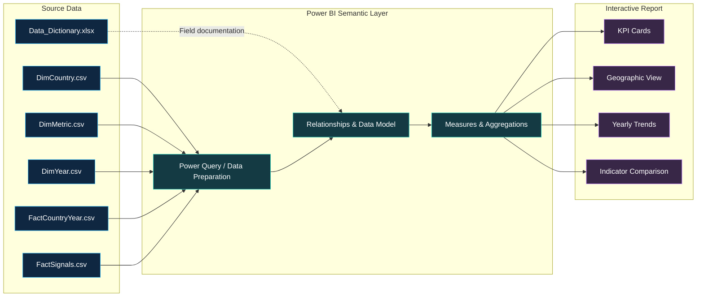
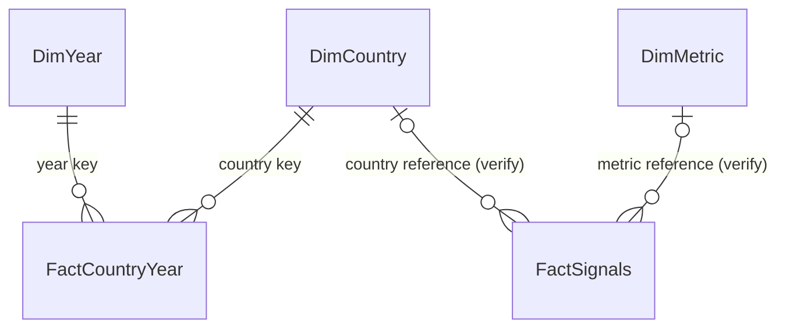

<div align="center">

# 🌍 ATLAS PULSE
### Global Resilience Analytics Dashboard

**Exploring economic stability, energy security, and climate resilience through interactive business intelligence.**

[](https://powerbi.microsoft.com/)


</div>

---

## 📸 Dashboard Preview

<!-- SCREENSHOT PLACEHOLDER
1. Open a GitHub issue in this repository.
2. Drag your dashboard screenshot into the issue editor and wait for the upload to finish.
3. Copy the generated image URL.
4. Replace YOUR_GITHUB_ISSUE_IMAGE_URL below with that URL.
5. Remove the HTML comment markers around the image line when ready.
-->

<!--  -->

> **Screenshot pending:** The final dashboard preview will be embedded here using a GitHub-hosted image URL copied from an issue.

## ✨ Overview

**ATLAS PULSE** is a Microsoft Power BI dashboard designed to make multidimensional global resilience indicators easier to explore and interpret. It combines a geographic overview with high-level performance indicators and time-series comparisons in a single dark-themed analytical interface.

The report focuses on three complementary questions:

- **Where?** Explore country-level geographic patterns and resilience scores.
- **How much?** Monitor aggregate indicators and the distribution of resilience-related measures.
- **How has it changed?** Compare resilience and economic stability across reporting years.

> **Interpretation note:** The dashboard presents analytical indicators from its supplied dataset. They are not official forecasts, causal conclusions, or validated country-risk ratings unless independently established by the underlying source methodology.

## 🎯 Dashboard Capabilities

| Component | Purpose |
|:--|:--|
| **Total Countries** | Count of countries represented in the report context |
| **Average Resilience Score** | Summary of the dataset's resilience score |
| **High Risk (%)** | Share identified as high risk by the model's configured definition |
| **Momentum** | Summary indicator of directional change, as defined in the report model |
| **Global Resilience Map** | Geographic exploration of country-level resilience indicators |
| **Resilience Score Trend by Year** | Comparison of average resilience score and economic stability over time |
| **Risk Composition** | Side-by-side comparison of economy, energy, and climate-related measures |

**Important:** The economy, energy, and climate bars should be interpreted according to their underlying measure definitions; their display in a panel named “Risk Composition” does not by itself mean that higher values represent higher risk.

## 🧭 Analytics Architecture



*Conceptual workflow based on the project files and visible report components. Exact Power Query transformations, relationships, and measure formulas should be verified against the `.pbix` model.*

## 🗂️ Dataset & File Structure

```text
ATLAS-PULSE-Global-Resilience/
├── ATLAS_PULSE_Global_Resilience.pbix
├── README.md
├── data/
│   ├── Data_Dictionary.xlsx
│   ├── DimCountry.csv
│   ├── DimMetric.csv
│   ├── DimYear.csv
│   ├── FactCountryYear.csv
│   └── FactSignals.csv
└── screenshots/                 # Optional: local image assets
```

| File | Role |
|:--|:--|
| `DimCountry.csv` | Country dimension and geographic attributes |
| `DimMetric.csv` | Metric reference information |
| `DimYear.csv` | Reporting-year dimension |
| `FactCountryYear.csv` | Country-by-year analytical observations |
| `FactSignals.csv` | Supporting signal/indicator observations |
| `Data_Dictionary.xlsx` | Reference documentation for source fields |
| `ATLAS_PULSE_Global_Resilience.pbix` | Power BI report and semantic model |

### Data model — conceptual view



> The ER diagram is **illustrative**, not an assertion of the exact configured Power BI relationships. Confirm keys, cardinality, filter direction, and whether `FactSignals` connects to these dimensions in **Model view** before treating it as authoritative.

## 🛠️ Technology Stack

| Technology | Usage |
|:--|:--|
| **Microsoft Power BI Desktop** | Report development, modeling, and interactive visualizations |
| **Power Query** | Data import and preparation within Power BI |
| **DAX / Power BI measures** | Aggregation and KPI calculations, as configured in the report |
| **CSV** | Structured analytical source tables |
| **Microsoft Excel** | Data dictionary and field documentation |
| **Git & GitHub** | Source distribution, documentation, and version control |

## 🚀 Run Locally

1. Clone or download this repository.
2. Install **[Microsoft Power BI Desktop](https://www.microsoft.com/en-us/power-platform/products/power-bi/desktop)** on Windows.
3. Open `ATLAS_PULSE_Global_Resilience.pbix`.
4. If Power BI reports missing data sources, open **Home → Transform data → Data source settings** and update the file paths to the CSV files in `data/`.
5. Select **Refresh** to load the data and inspect the report pages.

> **No Power BI organizational account is required simply to open a local `.pbix` in Power BI Desktop.** Online publishing, sharing, and some cloud-backed visuals may have separate account or licensing requirements.

## 🔍 Analytical Design Principles

- **Context first:** Lead with a small number of KPIs before presenting geographic and temporal detail.
- **Comparability:** Display measures side by side while retaining their proper units and definitions.
- **Traceability:** Keep source CSVs and the data dictionary alongside the report where redistribution is permitted.
- **Interpretability:** Distinguish descriptive indicators from predictive or causal claims.
- **Visual hierarchy:** Use a consistent dark canvas with contrasting accents for charts and key metrics.

## 🧪 Quality & Validation Checklist

- [ ] Verify data types and missing values across source tables.
- [ ] Confirm country identifiers and latitude/longitude mappings.
- [ ] Check Power BI relationships and aggregation behavior.
- [ ] Validate KPI calculations against source records.
- [ ] Verify the definition and direction of **High Risk (%)** and **Momentum**.
- [ ] Confirm whether economy, energy, and climate measures are **scores** or **risk values**.
- [ ] Test slicers, cross-filtering, and visual interactions.
- [ ] Refresh the report from the repository's `data/` directory.
- [ ] Confirm that source datasets may legally be redistributed.

## 🖼️ Adding Screenshots from GitHub Issues

You can host the preview directly on GitHub without committing a separate screenshot file:

1. Open **Issues → New issue** in your repository.
2. Drag your dashboard image into the issue description.
3. Wait for the upload and copy the generated image URL.
4. Replace the screenshot placeholder near the top of this README with:

```markdown

```

5. Remove the “Screenshot pending” line.

**Tip:** You can use a draft issue for uploading, but keep in mind that image availability and access can depend on repository and GitHub attachment permissions.

## 🧩 Future Improvements

- [ ] Add a source/methodology section with dataset provenance and indicator definitions.
- [ ] Document verified DAX measures and the final model relationships.
- [ ] Add country and regional filtering where useful.
- [ ] Improve map readability and accessibility without sacrificing analytical accuracy.
- [ ] Add a dedicated documentation screenshot of the Power BI model view.
- [ ] Review responsive layout and export quality.

## 📄 Data & Licensing

This repository may include data from sources with separate usage or redistribution conditions. **Check the original dataset's license and attribution requirements before making the repository public.** No open-source license is implied unless a `LICENSE` file is explicitly added.

---

<div align="center">

**ATLAS PULSE** · *Turning complex indicators into understandable insights.*

Built with **Microsoft Power BI** · Documented for reproducibility and portfolio review

</div>
